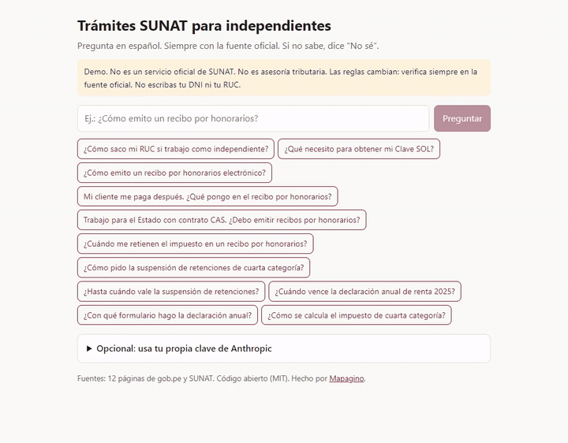

# Trámites Perú RAG

Chat en español sobre trámites SUNAT para trabajadores independientes. Siempre con la fuente oficial. Si no sabe, dice "No sé".

> **Demo.** No es un servicio oficial de SUNAT. No es asesoría tributaria. Las reglas cambian: verifica siempre en la fuente oficial.



[Ver el video (MP4 con voz, 32 s)](docs/demo.mp4)

## Pruébalo en 2 minutos, sin clave

1. Haz clic en una pregunta de ejemplo → ves la respuesta, la cita exacta, el enlace oficial y la fecha de revisión.
2. Escribe tu propia pregunta (ej.: "requisitos para la suspensión de retenciones") → ves los fragmentos oficiales que la responden.
3. Escribe algo fuera de tema (ej.: "¿Cómo renuevo mi DNI?") → la demo dice **"No sé"** y te manda a la orientación de SUNAT.
4. Opcional: pega tu propia clave de Anthropic → Claude redacta la respuesta y cita cada fuente. Tu clave, tu costo.

## Por qué puedes confiar (y qué no está probado)

- **Solo fuentes oficiales:** 12 páginas de `gob.pe` y `orientacion.sunat.gob.pe` (`corpus/sources.json`, con la fecha de revisión de cada una).
- **Citas verificadas por código:** cada cita de las respuestas de ejemplo está palabra por palabra en su fuente (`tests/samples.test.ts`).
- **"No sé" lo decide el código, no la IA:** si la búsqueda no encuentra una coincidencia fuerte, no hay respuesta y no se llama a la IA. Umbral congelado en `evals/threshold.json`, fijado solo con `evals/tune.json`.
- **Evaluación con preguntas no usadas para ajustar** (`evals/test.json`, 24 casos, 2026-11-19): fuente correcta en el top 3 en **14/16**; "No sé" con precisión **0.71** y recall **0.63** (8 casos fuera de tema). Es un set pequeño. Detalle en `evals/results/`.
- **Revisión semanal** de que las páginas oficiales no cambiaron (`npm run check-live`).
- **Qué NO prueba la CI:** las respuestas redactadas por Claude (modo con clave). La CI prueba la búsqueda, la puerta "No sé", las citas y la forma exacta de la llamada a la API (con un fetch simulado). No afirmamos resistencia a prompt injection en ese modo.

## Si usas tu propia clave

No necesitas clave: el modo gratis ya muestra la demo. Si quieres probar con Claude:

1. Crea una clave nueva en un workspace aparte de Anthropic, con un límite de gasto bajo (ej.: USD 1). Bórrala después de probar.
2. Lee el código que envía la clave: [`src/lib/anthropic.ts`](src/lib/anthropic.ts) (un solo `fetch`).
3. Abre la pestaña Red (Network) de tu navegador: verás llamadas solo a `api.anthropic.com`.

## Arquitectura

Sin servidor: todo corre en tu navegador.

```
pregunta → búsqueda BM25 (MiniSearch + stemmer Snowball en español) → ¿coincidencia fuerte?
   no → "No sé" + enlace a SUNAT
   sí → sin clave: fragmentos oficiales con enlace y fecha
        con clave: Claude (API de Anthropic, citations) redacta con citas
```

- Front end: React + TypeScript + Vite, sitio estático en GitHub Pages.
- Seguridad: Content-Security-Policy por `<meta>` (solo permite llamadas a este sitio y a `api.anthropic.com`), sin scripts de terceros, sin analítica, el texto del modelo se muestra como texto (ESLint prohíbe HTML crudo). Tu clave queda en memoria; "Recordar en esta pestaña" (sessionStorage) está apagado por defecto. Límite conocido: una CSP por `<meta>` no impide que otro sitio muestre esta página en un marco (clickjacking).

## Correr localmente

```bash
npm ci
npm run dev        # o: npm run build && npm run preview
npm test && npm run eval
```

Otros: `npm run snapshot` (vuelve a descargar las fuentes), `npm run check-live` (revisa que las páginas oficiales no cambiaron).

## Fuentes

Texto de páginas públicas del Estado peruano (gob.pe, SUNAT). Cada fuente guarda su URL y la fecha de revisión, y cada respuesta enlaza a la página original. El texto pertenece a su fuente. Código: MIT.

Hecho por [Mapagino](https://mapagino.com/services).
